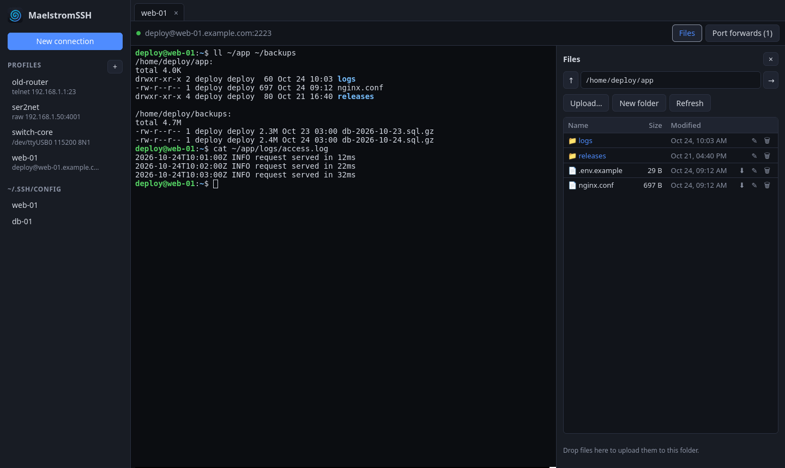
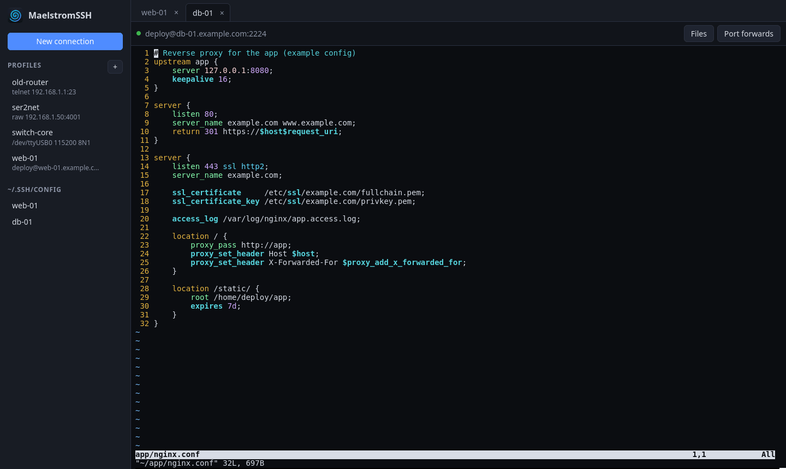
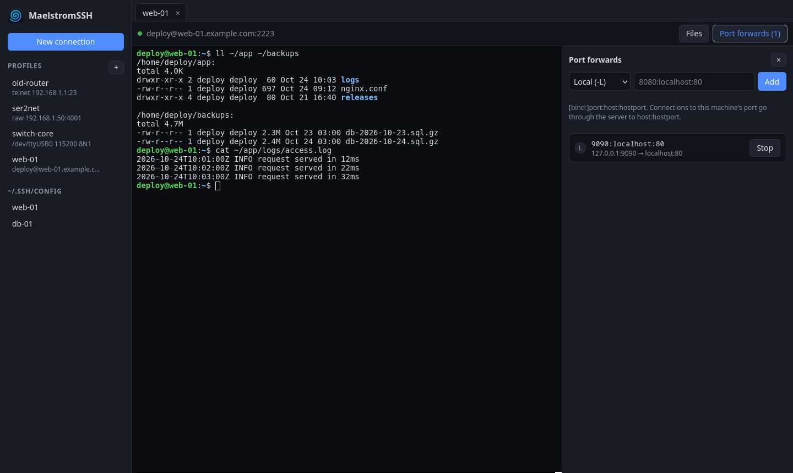
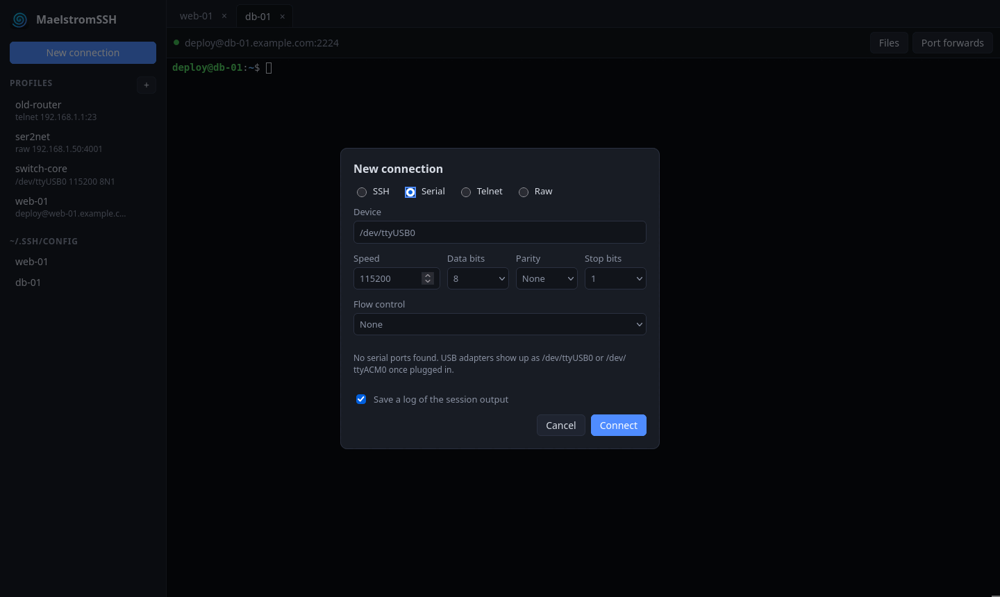

<p align="center">
  
</p>

<h1 align="center">MaelstromSSH</h1>

<p align="center">
  An SSH/SFTP, serial, Telnet and raw TCP client for Linux, written in Rust — use it from the command line, a full-screen
  terminal UI, a desktop window or your web browser, all driven by one shared engine.
</p>

<p align="center">
  <a href="https://github.com/TuxoJlumoH/maelstromssh/actions/workflows/ci.yml"></a>
  <a href="https://github.com/TuxoJlumoH/maelstromssh/releases/latest"></a>
  
</p>

<p align="center">
  
</p>

## Features

- **SSH** — works like OpenSSH out of the box: `ssh-agent`, `~/.ssh` keys, password and keyboard-interactive (2FA), `~/.ssh/config` host aliases, and trust-on-first-use host-key verification.
- **SFTP** — scriptable `get`/`put`/`ls`/`rm`/`mkdir`/`rename`, an interactive shell, and a drag-and-drop file browser in the web UI.
- **Port forwarding** — local, remote, and dynamic (SOCKS5 proxy); the web UI adds and stops forwards while connected.
- **Serial / COM ports** — open `/dev/ttyUSB0`, `/dev/ttyACM0`, `/dev/ttyS0` etc. with any baud rate, data bits, parity, stop bits and flow control, and send a break; in the CLI and the web UI.
- **Telnet and raw TCP** — for old switches, routers and serial-over-IP adapters: Telnet option negotiation (window size, terminal type, break), or bytes passed through unchanged.
- **Session logging** — save everything a session prints to a file (`--log` in the CLI, a checkbox in the web UI).
- **Key generation** — Ed25519 and RSA (configurable size).
- **Full terminal emulator** — 256-color + truecolor, scrollback, reflow-on-resize, scroll regions, alternate screen, mouse reporting, bracketed paste.
- **Profiles** — saved connection settings, including port forwards.

> Formerly **VortexSSH**. Profiles and logs in the old `vortexssh` folders are moved
> to the new ones automatically on first run.

## Screenshots

| Full-screen apps (vim) | Port forwards | Serial port |
|---|---|---|
|  |  |  |

All screenshots are of the web UI, taken against a test server with made-up hosts.

## Front-ends

| Binary | What it is |
|---|---|
| `maelstromssh` | Command line — connect, `serial`, `telnet`, `raw`, `sftp`, `profile`, `keygen` |
| `maelstromssh-tui` | Full-screen terminal UI (`ratatui`) |
| `maelstromssh-gui` | Desktop window (`egui`/`eframe`) |
| `maelstromssh-web` | Browser UI served on 127.0.0.1 (`axum` + `xterm.js`) |

`make install` and the Arch package also add `mssh` as a short alias for `maelstromssh`
(not in the `.deb`, where Debian's MultiSSH already owns `mssh`).

## Install

- **From source** (Rust stable):

  ```bash
  git clone git@github.com:TuxoJlumoH/maelstromssh.git
  cd maelstromssh
  make                          # cargo build --release
  sudo make install             # /usr/local, with a desktop entry and icons
  # or: make install PREFIX=~/.local
  ```

  `make uninstall` (with the same `PREFIX`) removes it again.
- **Arch / CachyOS**: `cd packaging/aur && makepkg -si` builds the tagged release. It clones
  over SSH, so it needs your GitHub key while the repository is private.
- **Debian / Ubuntu**: download the `.deb` from the
  [releases page](https://github.com/TuxoJlumoH/maelstromssh/releases) and run
  `sudo apt install ./maelstromssh_*.deb`.
- **Any Linux**: unpack the release tarball and copy its `bin/` and `share/` into
  `/usr/local` or `~/.local`.

## Usage

### Command line

```bash
maelstromssh connect user@host                       # agent, ~/.ssh keys, then password
maelstromssh connect -i ~/.ssh/id_ed25519 git@github.com
maelstromssh connect myalias                         # Host alias from ~/.ssh/config
maelstromssh connect -L 8080:localhost:80 user@host  # local forward
maelstromssh connect -D 1080 user@host               # SOCKS5 proxy
maelstromssh sftp user@host                          # interactive SFTP shell
maelstromssh keygen -t ed25519                       # generate a key
maelstromssh profile add mybox user@host -p 2222
maelstromssh serial --list                           # serial ports on this machine
maelstromssh serial /dev/ttyUSB0 -b 115200           # serial console (Ctrl-] q quits)
maelstromssh profile add router /dev/ttyUSB0 --serial -b 9600
maelstromssh telnet 192.168.1.1                      # Telnet (port 23; not encrypted)
maelstromssh raw 192.168.1.50 4001                   # raw TCP
maelstromssh telnet 192.168.1.1 --log ~/logs         # save the output to ~/logs/192.168.1.1-<date>-<time>.log
```

Serial devices usually belong to the `uucp` group on Arch (`dialout` on
Debian/Fedora); add yourself with `sudo usermod -aG uucp $USER` and log in again.

### Terminal UI and desktop window

```bash
maelstromssh-tui user@host
maelstromssh-gui                     # opens a connect form
maelstromssh-gui user@host
```

The desktop window asks for passwords, passphrases and host-key confirmation
inside the window, so it also works when started from the app menu.

### Web UI

```bash
maelstromssh-web                     # starts the server and opens your browser
maelstromssh-web --no-browser        # only print the login link
maelstromssh-web --port 9000         # another port (default 8022, or a free one)
```

Each browser tab is one SSH connection with:

- a terminal;
- a file browser — upload (button or drag and drop), download, rename, delete, new folder;
- port forwards you can add and stop while connected.

or one serial port, Telnet or raw TCP connection (choose the type in *New
connection*), with a terminal and, for serial and Telnet, a *Send break* button.

Saved profiles and your `~/.ssh/config` hosts are listed in the sidebar, and
profiles can be created and edited there. Login prompts appear as dialogs.
Ctrl-C in the terminal where it runs stops the server.

**Security:** the server only accepts connections from this machine, and only
with the random login link it prints at startup (which stops working when the
server stops). Keep the link private. Passwords are never stored.

**From another computer** (e.g. a Mac), tunnel the port over SSH and use the
same port number on both ends:

```bash
ssh -L 8022:127.0.0.1:8022 you@linux-box maelstromssh-web --no-browser -p 8022
```

Then open the printed link on that computer. SSH connections still start from
the Linux machine, using its keys and profiles, and forwards open ports there.

## Project layout

```
core/    maelstromssh-core — protocol engine (SSH, SFTP, tunnel, keys, terminal)
cli/     maelstromssh      — command line
tui/     maelstromssh-tui  — ratatui terminal UI
gui/     maelstromssh-gui  — egui/eframe desktop window
web/     maelstromssh-web  — browser UI (axum server + plain JS, xterm.js vendored)
assets/                 — app icon (SVG/PNG)
packaging/              — desktop entry, Arch PKGBUILD
```

## Roadmap

- Serial, Telnet, raw TCP and session logging in the terminal UI and desktop window
  (today they are in the command line and the web UI).
- SFTP file browser and port forwards in the terminal UI and desktop window.

## Documentation

Full usage and API reference: [`HELP.md`](HELP.md).

## License

Licensed under either of [Apache License, Version 2.0](LICENSE-APACHE) or
[MIT license](LICENSE-MIT), at your option.

The web UI bundles [xterm.js](https://xtermjs.org) and its fit addon, both
under the MIT license; see `web/assets/vendor/`.
